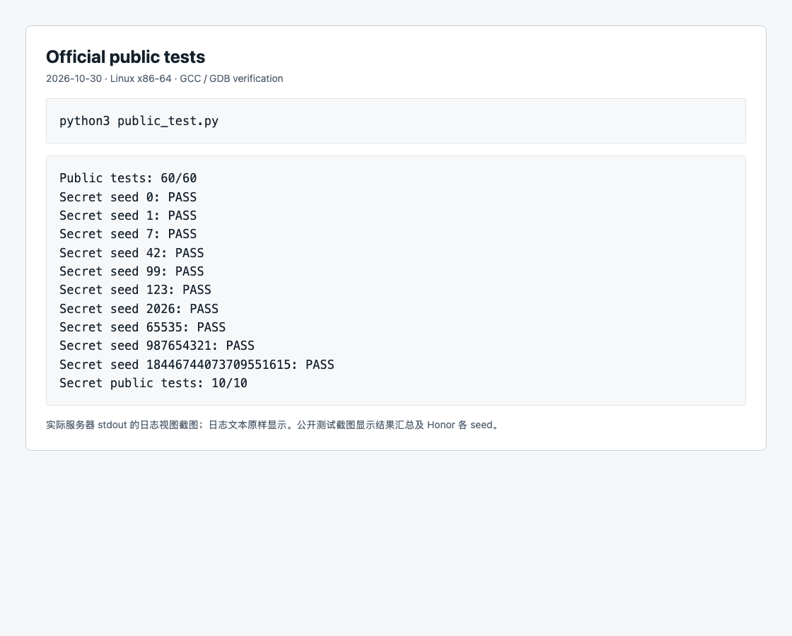
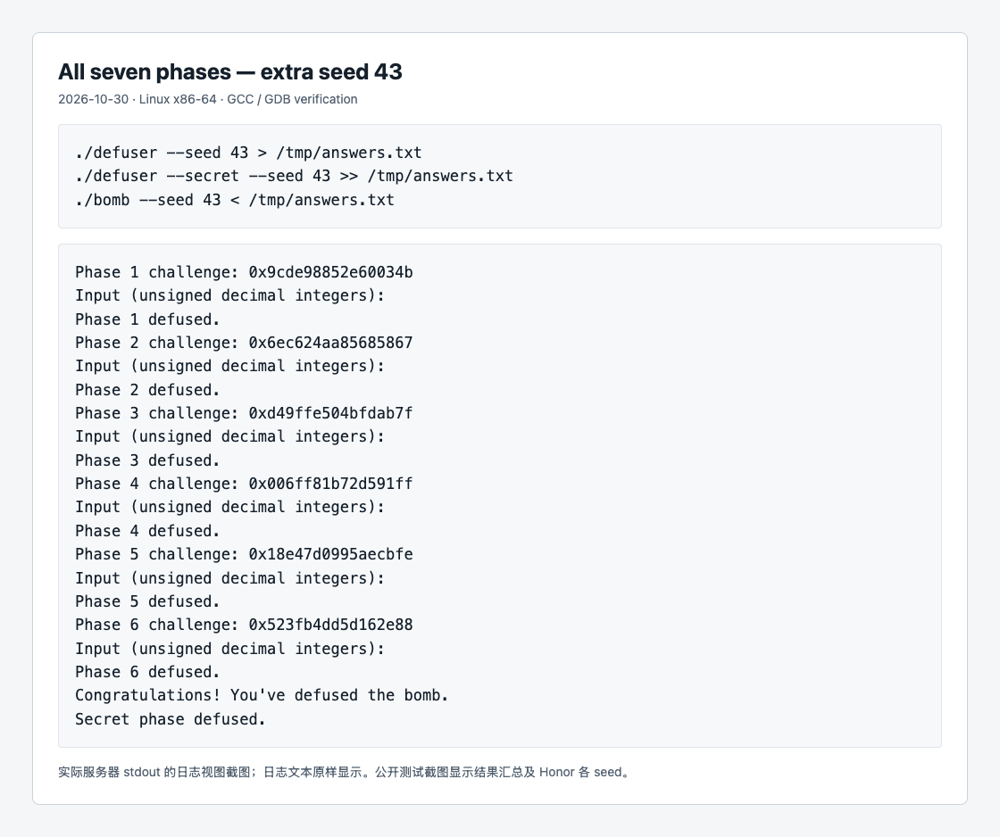

# Lab2：BombLab 实验报告

## 环境与实现范围

实验在 Linux x86-64 环境中运行，使用 GCC、GNU Make、GDB、objdump 和 Python 3。解法代码仅修改 `defuser.c`，保留模板接口、驱动、测试程序及 Actions 工作流。六个正式关卡和 Honor 均已实现。

个人炸弹的 SHA-256 为 `fc35cc2054a7831a1350194373067b6d03ce6248240b7308dc0070e4cf4b44ac`。以下计算均来自这份二进制的指令与静态数据。32 位计算使用 `uint32_t`，加减乘法结果按模 2^32 保留，`^` 表示按位异或。

## 分析过程与计算关系

### 第 1 关：函数调用与参数传递

`phase_01` 用 `%u` 读取一个整数，调用 `p1_compute`，再将返回的 `eax` 与输入比较。入口处 challenge 在 `rsi`，随后保存到 `r12`；进入 `p1_compute` 时转入 `rdi`。

设 `C` 为 challenge，`H=(uint32_t)(C>>32)`、`L=(uint32_t)C`、`M=(uint32_t)(C>>16)`。三个辅助函数的关键指令分别是 `lea`、`add` 和 `xor`，恢复为：

```text
step2(a,b) = (5*a) ^ (b + 0x63e9)
step0(a,b) = (3*a + b) ^ 0x8cc1
step1(a,b) = (b + 0x8830) ^ a
答案 = step1(step0(L,M), step2(H,L))
```

参数应根据被调用函数实际读取的寄存器判断。例如保存中间结果的 `ecx` 不能仅因它属于参数寄存器就视作该函数的有效参数。调试 seed 42 时，`step2` 返回 `0x7ec83b13`，与恢复出的计算一致。

### 第 2 关：数组、循环与递推

`sscanf` 的返回值与 6 比较，说明需要六个整数。输入数组从 `rbp-0x40` 开始，`-0x40(%rbp,%rdx,4)` 读取第 `rdx` 个 32 位元素。

第一个数由 `shr $6`、`movzbl %al,%eax`、三倍的 `lea` 得到。循环中 `rdx` 从 1 增至 5，`cl` 从 7 开始，每轮增加 2：

```text
f[0] = 3 * ((C >> 6) & 0xff)
f[i] = ((((C >> (2*i+5)) & 0x3f) + 1) ^ (3*f[i-1] - i)), i=1..5
```

seed 42 的第一次循环中，异或前 `eax=63`、`esi=1124`，异或后为 1115。读取实际输入的 `f[1]=1115` 后，`cmp` 令 `ZF=1`，随后的 `jne` 不进入失败分支。

### 第 3 关：跳转表与分支

本关读取两个整数。第一个必须等于 `C & 7`。随后传给 `p3_dispatch` 的数据为：

```text
index = C & 7
v = (uint32_t)(C >> 32) ^ (uint32_t)(C >> 3)
```

`jmp *0x405820(,%rax,8)` 从跳转表读取目标地址，再跳到相应分支。表项顺序与辅助函数的符号编号不同，不能按名称猜测索引：

| index | 实际函数 | 第二个整数 |
| ---: | --- | --- |
| 0 | `p3_case_6` | `(v ^ 0xbfd0) + (v >> 2)` |
| 1 | `p3_case_5` | `5*v + 0x1da79` |
| 2 | `p3_case_3` | `(v ^ 0x1cb5) + (v >> 1)` |
| 3 | `p3_case_1` | `5*v + 0xdc6e` |
| 4 | `p3_case_0` | `3*v + 0xcf30` |
| 5 | `p3_case_4` | `(2*v) ^ 0x51e1` |
| 6 | `p3_case_7` | `3*v + 0xb83b` |
| 7 | `p3_case_2` | `(4*v) ^ 0x4ac5` |

seed 42 中，索引 4 对应表项地址 `0x405840`，表项内容为 `0x402298`，该处再跳至 `p3_case_0`；返回的第二个整数为 763496407。

`case_3`、`case_6` 先把原始 `edi` 复制到 `eax`，再右移 `edi`。因此异或操作使用原始 `v`，加法的另一项才是右移后的值。

### 第 4 关：递归搜索与返回值

`phase_04` 调用 `p4_walk`，初始参数为：

```text
target = C & 0x7f
low = 0, high = 127
salt = (uint32_t)(C >> 7) ^ (uint32_t)(C >> 32)
```

函数先计算 `mid = low + ((high-low)>>1)`。`cmp`、`je` 判断是否命中；后面的无符号 `jb` 判断是否进入左半区间。设递归返回结果为 `child`：

| 条件 | 下一步与返回值 |
| --- | --- |
| `target == mid` | 返回 `(mid + 0x19) ^ salt` |
| `target < mid` | 递归 `[low,mid-1]`，返回 `(3*child) ^ (mid+salt) ^ 0x0e` |
| `target > mid` | 递归 `[mid+1,high]`，返回 `(3*child) ^ (mid+salt) ^ 0x13` |

seed 42 的目标为 114，区间依次为 `[0,127]`、`[64,127]`、`[96,127]`、`[112,127]`、`[112,118]`、`[112,114]`、`[114,114]`。到达终止条件后，结果按相反顺序逐层返回，最终为 1434872728。

### 第 5 关：结构体与链表遍历

`p5_traverse` 从头指针表选择节点。`mov (%rdx),%rdx` 读取下一个节点地址，`mov 0x8(%rdx),%esi` 和 `add 0xc(%rdx),%eax` 分别访问节点的两个整数。节点共 16 字节：

| 偏移 | 字段 | 大小 |
| ---: | --- | ---: |
| 0 | `next` 指针 | 8 字节 |
| 8 | `tag` | 4 字节 |
| 12 | `bias` | 4 字节 |

从二进制读取 12 个节点及 8 个头指针后，在 C 中保留同样的链接关系。以节点表地址顺序编号，头节点编号为 `{5,7,1,10,3,0,8,6}`。

```text
head_index = C & 7
hops = (C >> 3) & 3
acc = (uint32_t)(C >> 6) ^ (uint32_t)(C >> 32) ^ 0x2c04
每访问一个节点：acc = (3*acc + node.bias) ^ node.tag
```

先处理头节点，再沿 `next` 前进 `hops` 次，总共处理 `hops+1` 个节点。输出最终 `acc` 和最后节点的 `tag`。seed 43 访问节点 `8→6→9→2`，最终输出 `3601866002 64`。

### 第 6 关：函数指针表与间接调用

两条间接 `call` 使用同一张 8 项函数指针表。第一个索引为 `C&7`；第二条使用字节偏移 `C&0x38`，因此第二个索引为 `(C>>3)&7`。

六个运算函数恢复如下，`ROR`、`ROL` 均为 32 位循环移位：

| 函数 | 返回值 |
| --- | --- |
| op0 | `ROR(v,1)` |
| op1 | `(v ^ 0xd0b4) + 2*v` |
| op2 | `(v + 0x1f88) ^ (v >> 1)` |
| op3 | `((v >> 5) ^ v) + 0x59f9` |
| op4 | `ROL(v,5) ^ 0x19df` |
| op5 | `(8*v + 0xa3bf) ^ (7*v)` |

指针表顺序为 `{op4,op5,op5,op0,op2,op0,op1,op3}`，其中有重复项。设该表为 `ops`：

```text
v = (uint32_t)(C >> 6) ^ (uint32_t)(C >> 32)
t = ops[C & 7](v) ^ 0x3f3a
答案 = ops[(C >> 3) & 7](t) + 0x3a95
```

### Honor：相邻字段与上下文校验

Honor 需要同一次运行的前六关全部正确，并继续从文件或管道读取第七行。`context` 由驱动根据前六行答案计算，不能作为固定常数写入解法。

`secret_gate` 的复制目标从 `rbp-0xd0` 开始。它在 `rbp-0xb0` 比较 `0x4e45504f`，两者相差 32 字节。按小端字节序，该常数对应 `OPEN`。随后把 `rbp-0xac`，即起点后 36 字节处，传给 `secret_phase` 解析三个整数。因此第七行构造为：

```text
32 个 A + OPEN + 第一个整数 + 空格 + 第二个整数 + 空格 + 第三个整数
```

`secret_copy` 连同末尾 NUL 一起复制。当前构造最多 59 个字符，满足入口检查的 36 至 163 字符范围；利用的是局部对象内的相邻字段关系，不涉及返回地址。

设 `C` 是 Honor challenge，`K` 是 context，以下中间量为 32 位：

```text
m = K & 3
a = (uint32_t)C ^ (uint32_t)(C >> 32)
b = (uint32_t)K ^ (uint32_t)(K >> 32)
q = ROR(a ^ b, 5) ^ 0x4bbd
f0 = m
f1 = q ^ (m * 0x9e88) ^ (uint32_t)(K >> 16)
f2 = f1 ^ (b + m + 0xd535 + (a >> 5))
```

其中 `secret_mix` 对输入执行 `ror $5` 和异或 `0x4bbd`；之后两次比较分别核对 `f1`、`f2`。输出通过 `snprintf` 写入接口提供的缓冲区，并检查是否截断。

## 实际验证记录

2026-10-30 在课程 Linux 服务器上以 `-std=c11 -O2 -Wall -Wextra -Wpedantic -Werror` 编译通过。完整执行 `python3 public_test.py`，六关共 **60/60**，Honor **10/10**。Honor 的四种 `context&3` 模式均出现在这批通过的公开 seed 中。



上图是实际服务器 stdout 的本地日志视图截图，显示常规关卡汇总和 Honor 各 seed；不是额外生成的测试结果。

另使用公开列表之外的 seed **43**、**3141592653** 验证了完整七行输入，均输出 `Secret phase defused.`。seed 43 的具体输出为：

| 关卡 | 输出 |
| --- | --- |
| 1 | `496800093` |
| 2 | `291 857 2596 7781 23336 69986` |
| 3 | `7 2004969017` |
| 4 | `3898955123` |
| 5 | `3601866002 64` |
| 6 | `696422485` |
| Honor | 32 个 `A` 后接 `OPEN0 2438211502 1491189914` |



截图原样展示实际服务器运行输出；查看日志的界面在本地渲染。复现命令为：

```sh
make
python3 public_test.py
./defuser --seed 43 > /tmp/answers.txt
./defuser --secret --seed 43 >> /tmp/answers.txt
./bomb --seed 43 < /tmp/answers.txt
```

补充验证覆盖了第 3 关全部 8 个跳转索引、第 4 关全部 128 个目标、第 5 关全部 32 种头节点与步数组合，以及第 6 关全部 64 种两次调用索引组合，均通过对应个人炸弹检查。覆盖使用不同 seed，输出仍由 challenge 计算。这些检查不能替代助教的隐藏测试。

## 工具使用与参考资料

本报告使用 AI 编程助手 Codex 辅助草拟。辅助范围包括汇编和 GDB 解释、数据流与计算关系还原、C 求解代码生成、测试操作、结果截图和报告整理。交互学习中核对了参数寄存器、数组递推、跳转表以及分支中原值和移位后值的区别；后续递归、链表、函数指针与 Honor 的分析和实现也使用了 AI 辅助。上述公式是结合二进制与运行结果整理的程序语义。

GDB 调试使用断点、反汇编、单步、寄存器和内存查看；保存观察值时使用便利变量。没有通过修改炸弹寄存器或内存绕过检查。截图与测试结论来自实际执行，未使用其他同学的实现。

- [课程 Lab2 官方说明](https://ics-26fall-fdu.github.io/labs/lab2-bomb-lab/)：实验范围、Honor 入口、验证与提交要求。
- [官方 BombLab 模板及 README](https://github.com/ICS-26Fall-FDU/BombLab)：接口、驱动、公开测试与工具材料。
- 本仓库 `tutor/`、`teaching/`：函数调用、GDB 和局部对象复制的配套示例。
- 个人 `bomb` 的 `objdump`、GDB 输出：各关指令、跳转表、节点与函数指针数据的直接依据。
